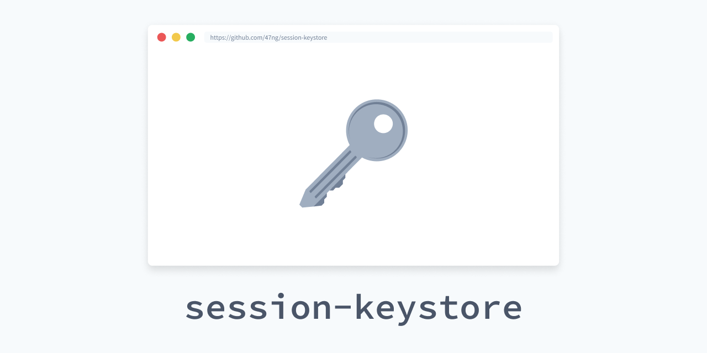

[](https://www.npmjs.com/package/session-keystore)
[](https://github.com/47ng/session-keystore/blob/master/LICENSE)
[](https://github.com/47ng/session-keystore/actions)
[](https://coveralls.io/github/47ng/session-keystore?branch=next)
[](https://dependabot.com)

Secure cryptographic key storage in the browser and Node.js

Ideal to store keys derived from user credentials (username/password) in
E2EE applications.

## Features

- In-memory storage: no clear-text persistance to disk
- Session-bound: cleared when closing tab/window (browser-only)
- Survives hard-reloads of the page (browser-only)
- Optional expiration dates
- Event emitter API for key CRUD operations

## Installation

```shell
$ yarn add session-keystore
# or
$ npm i session-keystore
```

## Usage

```ts
import SessionKeystore from 'session-keystore'

// Create a store
const store = new SessionKeystore()

// You can create multiple stores, but give them a unique name:
// (default name is 'default')
const otherStore = new SessionKeystore({ name: 'other' })

// Save a session-bound key
store.set('foo', 'supersecret')

// Set an expiration date (Date or timestamp in ms)
store.set('bar', 'supersecret', Date.now() + 1000 * 60 * 5) // 5 minutes

// Retrieve the key
const key = store.get('bar')
// key will be null if it has expired

// Revoke a single key
store.delete('foo')

// Clear all keys in storage
store.clear()
```

## CRUD Event Emitter

Event types:

- `created`
- `read`
- `updated`
- `deleted`
- `expired`

Listen to events on a keystore with the `on` method:

```ts
import SessionKeystore from 'session-keystore'

const store = new SessionKeystore()
store.on('created', ({ name }) => console.log('Key created: ', name))
store.on('updated', ({ name }) => console.log('Key updated: ', name))
store.on('deleted', ({ name }) => console.log('Key deleted: ', name))
store.on('expired', ({ name }) => console.log('Key expired: ', name))
store.on('read', ({ name }) => console.log('Key accessed: ', name))
```

Note: `deleted` will be called when the key has been manually deleted,
and `expired` when its expiration date has arrived.

When setting a key that is already expired, `created` or `updated` will
NOT be called, and `expired` will be called instead.

## TypeScript

`session-keystore` is written in TypeScript. You can tell a store about the keys it is supposed to hold:

```ts
import SessionKeystore from 'session-keystore'

const store = new SessionKeystore<'foo' | 'bar'>()

store.get('foo') // ok
store.get('bar') // ok
store.get('egg') // Error: Argument of type '"egg"' is not assignable to parameter of type '"foo" | "bar"'
```

This can be handy if you have multiple stores, to avoid accidental key leakage.

## How it works

Heavily inspired from the [Secure Session Storage](https://github.com/ProtonMail/proton-shared/blob/master/lib/helpers/secureSessionStorage.js#L7) implementation by [ProtonMail](https://protonmail.com),
itself inspired from Thomas Frank's [SessionVars](https://www.thomasfrank.se/sessionvars.html).

Read the [writeup article](https://francoisbest.com/posts/2019/how-to-store-e2ee-keys-in-the-browser) on [my blog](https://francoisbest.com/posts).

From the ProtonMail documentation:

> However, we aim to deliberately be non-persistent. This is useful for
> data that wants to be preserved across refreshes, but is too sensitive
> to be safely written to disk. Unfortunately, although sessionStorage is
> deleted when a session ends, major browsers automatically write it
> to disk to enable a session recovery feature, so using sessionStorage
> alone is inappropriate.
>
> To achieve this, we do two tricks. The first trick is to delay writing
> any possibly persistent data until the user is actually leaving the
> page (onunload). This already prevents any persistence in the face of
> crashes, and severely limits the lifetime of any data in possibly
> persistent form on refresh.
>
> The second, more important trick is to split sensitive data between
> `window.name` and sessionStorage. `window.name` is a property that, like
> sessionStorage, is preserved across refresh and navigation within the
> same tab - however, it seems to never be stored persistently. This
> provides exactly the lifetime we want. Unfortunately, `window.name` is
> readable and transferable between domains, so any sensitive data stored
> in it would leak to random other websites.
>
> To avoid this leakage, we split sensitive data into two shares which
> xor to the sensitive information but which individually are completely
> random and give away nothing. One share is stored in `window.name`, while
> the other share is stored in sessionStorage. This construction provides
> security that is the best of both worlds - random websites can't read
> the data since they can't access sessionStorage, while disk inspections
> can't read the data since they can't access `window.name`. The lifetime
> of the data is therefore the smaller lifetime, that of `window.name`.

### When the shares are written

This store does not wait for `unload` to write the `window.name` share.
Chromium applies writes to `window.name` made while the page unloads
(in `unload`, `pagehide` or `beforeunload`) one navigation late (seen in version 156):
the next page gets the value from one navigation earlier.

To avoid this, the store writes the `window.name` share each time a key changes,
and keeps the sessionStorage share in memory.
It writes the sessionStorage share on `pagehide` (or when you call `persist()`),
if `window.name` still holds its share.
It removes the sessionStorage share when the page loads or when a key changes,
so that share stays on disk only for a short time while the page is open.
A store with no keys removes its share from `window.name` and does not add a new one.

When the page comes back from the back/forward cache, it still holds the keys in memory.
If `window.name` still holds its share, it removes the sessionStorage share,
writes a new `window.name` share and keeps the new sessionStorage share in memory.
If not, it writes nothing until a key changes,
and an old sessionStorage share can stay on disk until then.

When the store cannot reach `window.top.name` or sessionStorage
(in a cross-origin iframe, or with storage blocked), it keeps keys in memory only.

Chromium usually keeps `window.name` when the tab goes to another site,
so that site can read the store name and the `window.name` share:
base64 text of random bytes. Its length shows the size of the stored JSON.
It cannot read the sessionStorage share, so it cannot rebuild the keys.
It can change or erase the `window.name` share, though:
when the user comes back, the store may then load changed keys or no keys.
In Chromium, a page that comes back from the back/forward cache gets its own `window.name` back,
so the other site's changes have no effect.
Firefox and WebKit clear `window.name` when the tab goes to another site.
Firefox restores it when the user comes back. WebKit does not, so the store loses the keys.

## License

[MIT](https://github.com/47ng/session-keystore/blob/master/LICENSE) - Made with ❤️ by [François Best](https://francoisbest.com)

Using this package at work ? [Sponsor me](https://github.com/sponsors/franky47) to help with support and maintenance.
